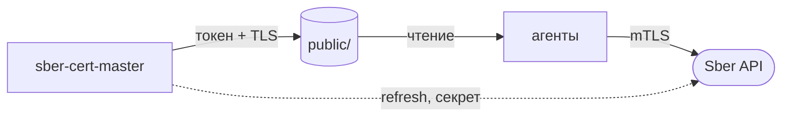

# sber-cert-master

Служба, которая держит доступ агентов к **Sber API (СберБизнес API)** живым: обновляет `access_token`/`refresh_token`, сама меняет `client_secret` до истечения, следит за TLS-сертификатом и цепочками CA (Сбер + Минцифры) и заранее предупреждает о том, что требует человека.

Запросы агентов **не проксируются и не ограничиваются**: агенты ходят в `https://fintech.sberbank.ru:9443` напрямую, служба только кладёт им на диск свежий токен и TLS-файлы.

## Сроки жизни учётных данных Sber API

По документации Sber API ([FAQ](https://developers.sber.ru/docs/ru/sber-api/faq/overview), [токены](https://developers.sber.ru/docs/ru/sber-api/specifications/oauth/oauth-token-post), [TLS](https://developers.sber.ru/docs/ru/sber-api/start/tls)) и по проверке на промышленном стенде:

| Что | Срок | Что делает служба |
|---|---|---|
| `access_token` | 60 минут; новая пара сразу отзывает предыдущий токен | обновляет заранее, публикует агентам |
| `refresh_token` | 180 дней с последнего использования; при каждом обновлении выдаётся новый, использованный остаётся резервным 2 часа | единственный владелец; после потерянного ответа повторяет тем же токеном |
| `client_secret` | 40 дней | меняет через API на 30-й день |
| TLS-сертификат клиента | 12 месяцев | предупреждает за 60 дней, ставит новый без простоя |
| CA Сбера и Минцифры | по сроку сертификатов CA | предупреждает, обновляет с проверкой отпечатков |

Без такой службы типичные причины потери доступа — истёкший `client_secret` и несколько агентов, обновляющих один `refresh_token` одновременно.

## Как устроено



Гарантии устойчивости:

- **Один отправитель.** Только служба отправляет `refresh_token` и `client_secret`, всегда под `flock`. Агенты этих значений не видят. Даже 8 параллельных процессов выполняют ровно один refresh (это проверено тестом).
- **Рабочее значение не затирается непроверенным.** Новую пару токенов служба сразу записывает через fsync. Новый секрет и импортированный `refresh_token` сохраняются кандидатами **до** отправки в банк и становятся текущими только после того, как банк их принял. Отклонённый кандидат отбрасывается, рабочее значение остаётся.
- **Потерянный ответ.** При таймауте, обрыве или 5xx служба повторяет запрос с тем же `refresh_token`: банк держит использованный токен резервным 2 часа. Если неизвестно, применил ли банк смену секрета, кандидат хранится 6 часов и пробуется первым при каждом refresh. Новая смена поверх нерешённой не запускается.
- **История секретов.** Все секреты за последние 14 дней остаются в закрытом состоянии. Если текущий секрет вдруг перестал приниматься (банк применил смену с опозданием), служба перебирает историю и переключается на тот, что работает.
- **Секреты не попадают в логи.** Из ответов банка в логи, состояние и алерты идут только HTTP-статус и код ошибки из разрешённого списка; описания и тела ответов отбрасываются. Запросы идут только по HTTPS, редиректы не выполняются.
- **Один профиль на client_id.** `client_secret` общий для client_id, поэтому два профиля с одним client_id конфиг не принимает: они сломали бы секрет друг другу.
- **Агент всегда получает токен, которому осталось жить не меньше 20 минут.** Если что-то сбоит, на исправление есть время до истечения токена, а алерт приходит раньше.
- **Смена TLS-сертификата без простоя.** Новый сертификат сначала проверяется реальным запросом к банку. Сертификат и ключ лежат в неизменяемом каталоге-поколении и включаются одной атомарной заменой symlink, поэтому сбой на любом шаге оставляет рабочую пару, а агент никогда не видит сертификат от одного поколения и ключ от другого. Старые сертификаты банк не отзывает, они работают до своей даты.
- **Сторож на таймере** (`check`, раз в 10 минут) поднимает тревогу, если упал сам демон.

## Установка

> Агент ставит службу сам по пошаговой инструкции [docs/AGENT_INSTALL.md](docs/AGENT_INSTALL.md); там же режим без root (`deploy/install-user.sh`, systemd --user).

Требуется Linux с systemd, Python ≥ 3.11 и `openssl`. Внешних зависимостей нет: установщик копирует файлы, `pip`, `venv` и доступ к индексу пакетов не нужны.

```sh
sudo ./deploy/install.sh                       # пользователь sber-cert-master, группа sber-agents, unit-файлы
sudo usermod -a -G sber-agents <пользователь-агента>
sudoedit /etc/sber-cert-master/config.toml     # client_id, redirect_uri, scope, каналы алертов
```

Первичная настройка (от пользователя службы):

```sh
sudo -u sber-cert-master -s
export SBER_CERT_MASTER_CONFIG=/etc/sber-cert-master/config.toml

# 1. client_secret + TLS-контейнер из ЛК Sber API (вкладка «Сертификаты шифрования»)
sber-cert-master init main --p12 /path/client.p12 --p12-password-file /path/p12.pass \
    --client-secret-file /path/secret.txt --secret-set-at 2026-11-20
#   без --secret-set-at секрет считается старым и сразу меняется при первом запуске

# 2. токены — один из вариантов:
sber-cert-master auth-url main           # открыть ссылку, войти в СберБизнес
sber-cert-master exchange-code main CODE # код из redirect_uri, живёт 2 минуты
#   или: выпустить токены в ЛК и
sber-cert-master import-refresh-token main < refresh_token.txt

sber-cert-master test-notify             # проверить, что алерты доходят
exit
sudo systemctl enable --now sber-cert-master sber-cert-master-check.timer
sber-cert-master status
```

После настройки удалите исходные файлы с секретом и паролем.

**Порядок важен:** отключите в агентах собственное обновление токенов и смену client_secret **до** `import-refresh-token` и запуска службы. Иначе старый агент может обновить токен или секрет одновременно со службой, и гонка из п. 2 повторится уже при переезде.

## Как агентам работать с банком

Агент ничего не обновляет. Перед каждым запросом (или после 401) он читает токен из файла:

```sh
. /var/lib/sber-cert-master/public/main/env
# заголовок идёт через stdin, чтобы токен не попал в аргументы процесса (ps, история); трассировку (set -x) держите выключенной;
# -q первым ключом: ~/.curlrc (trace, редиректы) не применяется
printf 'Authorization: Bearer %s\n' "$(cat "$SBER_ACCESS_TOKEN_FILE")" |
  curl -q --max-redirs 0 -H @- --cert "$SBER_CLIENT_PEM" --cacert "$SBER_CA_BUNDLE" "$SBER_API_BASE/fintech/api/v1/client-info"
```

```python
import json, ssl
P = "/var/lib/sber-cert-master/public/main/"
ctx = ssl.create_default_context(cafile=P + "ca-bundle.pem")
ctx.load_cert_chain(P + "tls/client.pem")                 # ключ и сертификат в одном файле; перечитывать при новом соединении
tok = json.load(open(P + "token.json"))["access_token"]   # перечитывать перед запросом
```

Или так: `sber-cert-master token main` печатает токен, которому осталось жить не меньше 2 минут. Если свежего токена нет, команда ждёт до 60 секунд и затем завершается с кодом 1. Конфиг службы агенту читать не нужно: без него команда сама находит стандартный каталог публикации, либо укажите `--publish-dir`.

Правила для агентов:
- **не кешируйте** токен дольше одного запроса: каждое обновление пары сразу отзывает предыдущий access_token (проверено на проде), а служба обновляет пару примерно раз в 40 минут. После `401` перечитайте файл (если токен тот же — подождите до 30 с, пока служба опубликует новый) и повторите запрос один раз;
- **не вызывайте** `/oauth/token`, `/change-client-secret` и `/refresh-client-secret`;
- сертификат и ключ берите либо одним файлом `tls/client.pem`, либо парой путей `SBER_CLIENT_CERT`/`SBER_CLIENT_KEY` из `env` (оба указывают в один неизменяемый каталог). Не читайте `tls/client.crt` и `tls/client.key` по отдельности через symlink: в момент замены можно получить файлы от разных сертификатов.

## Эксплуатация

**Самодиагностика:** `sber-cert-master diagnose main` собирает отчёт без секретов (состояние, журнал событий `events.jsonl`, предпроверку у банка, часы, сертификаты, права, systemd) и сам пишет выводы «что сломано → что делать». Работает и от агента (`--publish-dir ...`), который видит `health.json` службы. `--issue <owner/repo>` отправляет отчёт как issue в GitHub. Полный справочник ошибок (ответы реального банка, алерты, права доступа) — [docs/ERRORS.md](docs/ERRORS.md).

| Алерт | Что делать |
|---|---|
| `нужна повторная авторизация` | `auth-url` → вход → `exchange-code`, либо токены из ЛК → `import-refresh-token` |
| `автоматическая смена client_secret не удалась` | служба повторяет попытки сама. Если до истечения меньше 5 дней — `rotate-secret main` или смена в ЛК и `set-secret main` (служба проверит новый секрет у банка) |
| секрет истёк **и** нужен повторный вход | сменить секрет в ЛК, затем `auth-url main` → вход → `exchange-code main CODE --client-secret-file файл`: код обменивается с новым секретом, и он становится текущим |
| `TLS-сертификат истекает через N дн.` (с 60 дней) | 1) ЛК → «Сгенерировать сертификат» (или `csr main --inn … --ogrn … --locality Moscow --region Moscow --out dir` → письмо с `request.csr` на `supportdbo2@sberbank.ru`); 2) **привяжите новый сертификат к client_id в ЛК**; 3) только после этого `install-cert main --p12 new.p12` (или `--cert certificate.cer --key dir/private.key`) — команда проверяет сертификат запросом к банку, непривязанный будет отклонён (`403 certificateNotFound`). Работает и когда старый сертификат уже истёк или отозван |
| `доверенный CA истекает` | `update-ca`: скачивает CA с gu-st.ru и CDN Сбера. Корневые принимаются только при совпадении закреплённых отпечатков, промежуточные — только если они выстраиваются к закреплённому корню |
| отозваны и сертификат, и доступ пользователя | `install-cert` с новым сертификатом (он установится, команда попросит авторизацию), затем `auth-url` → `exchange-code` — обмен идёт уже через новый сертификат |
| `демон не работал` | `systemctl status sber-cert-master`, `journalctl -u sber-cert-master` |

Ещё команды: `status [--json]`, `refresh`, `tick`, `run --once`.

**Бессрочный client_secret.** В документации есть метод [`refresh-client-secret`](https://developers.sber.ru/docs/ru/sber-api/specifications/oauth/generate-secret-post), который выдаёт бессрочный секрет. Служба его намеренно **не вызывает**: новый секрет генерирует банк, и если ответ потеряется, восстановить значение нечем. Если хотите бессрочный секрет, получите его вручную (через ЛК или поддержку) и передайте службе командой `set-secret`.

## Состав

```
sber_cert_master/
  core.py    жизненный цикл токенов, секрета, TLS; публикация; tick
  client.py  mTLS-клиент к /oauth/token, /change-client-secret, user-info
  tls.py     встроенные CA с закреплёнными отпечатками, .p12, CSR, проверка цепочки
  notify.py  алерты с дедупликацией и повтором (warning — раз в сутки, critical — раз в 3 часа)
  ca/        Russian Trusted Root/Sub CA (Минцифры), SberCA Root Ext, SberAPI Root CA/CA
deploy/      systemd-юниты, install.sh, пример конфига
tests/       фейковый банк с mTLS, ротацией refresh_token и client_secret, имитацией сбоев
```

Тесты: `python3 -m unittest discover -s tests`. Временные файлы тестов лежат в `~/.cache/agent-tmp`, каталог можно задать через `SCM_TEST_TMP`.
